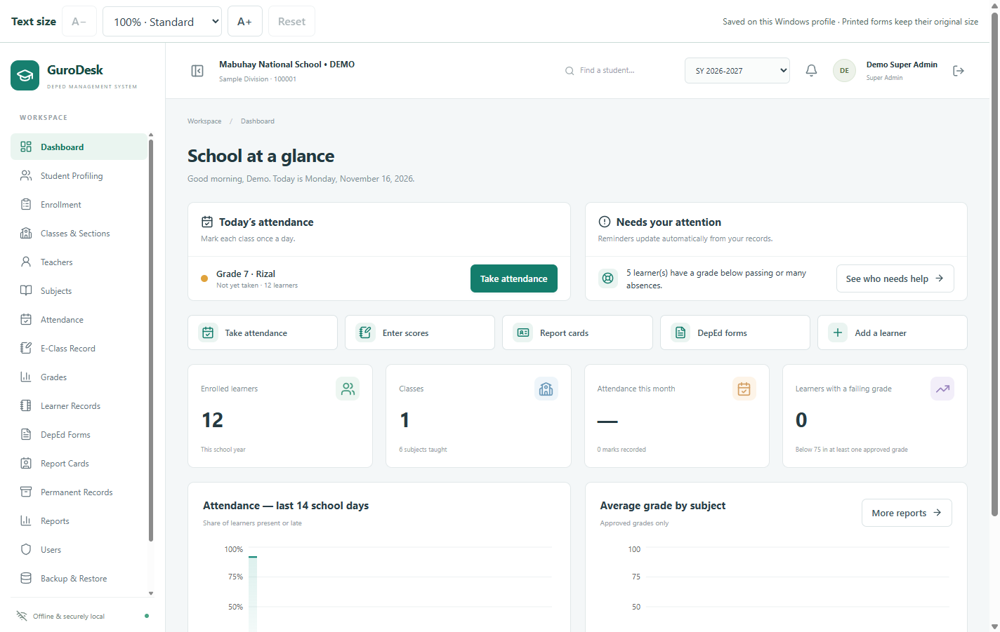
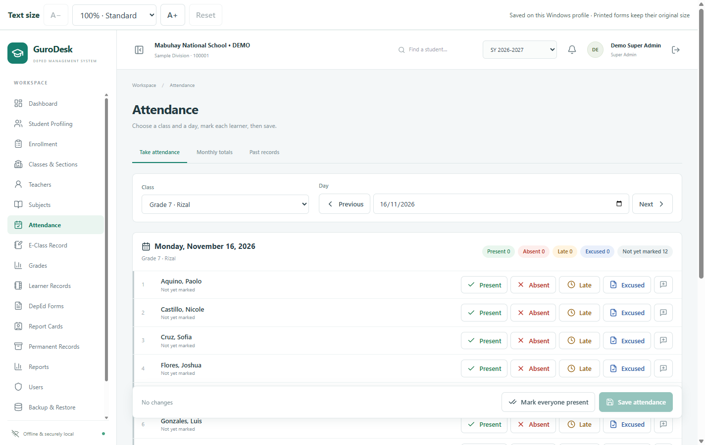
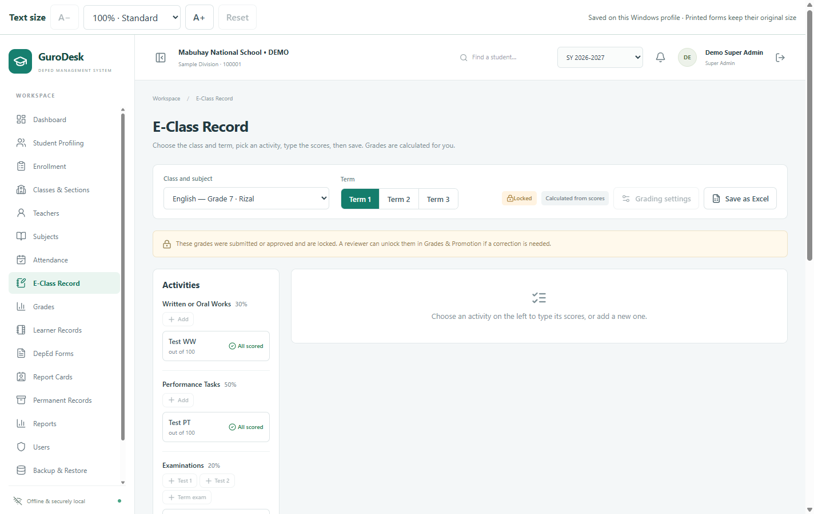
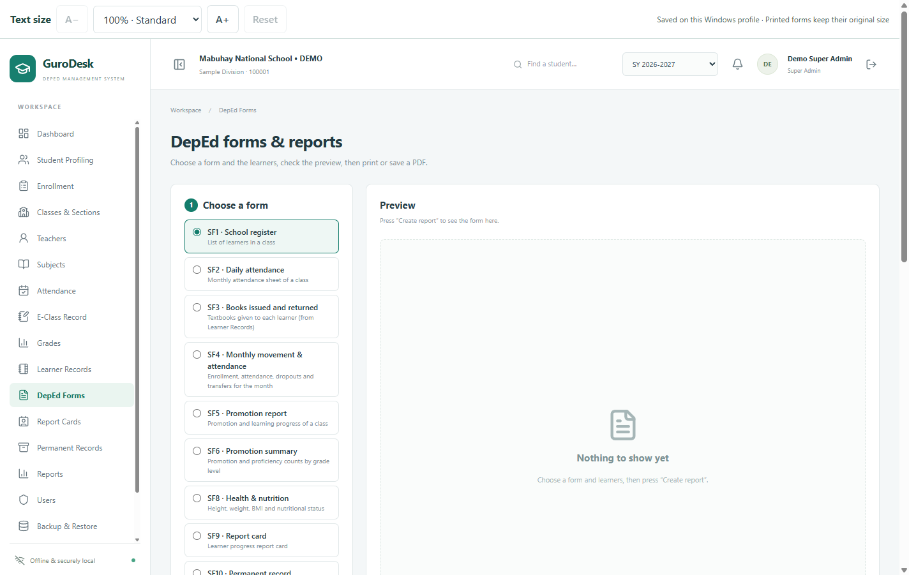

# GuroDesk

**Free for all teachers. Developed by Raymart Hernandez.**

GuroDesk is an offline Windows desktop app for school records: student profiles, enrollment, attendance, E-Class Record, grades, promotion, permanent records, and DepEd forms and reports (SF1, SF2, SF5, SF9, SF10 and more), with print/PDF and backup/restore. There is no license, trial, activation, or payment. Every feature works on every computer, and no internet connection is needed.



## Screenshots

| Attendance | E-Class Record |
| --- | --- |
|  |  |
| **Grades & promotion** | **Report cards (SF9)** |
|  |  |
| **DepEd forms & reports** | |
|  | |

*Screenshots use the built-in demo school with fictional learners.*

## Download

Get the latest version from the [**Releases page**](../../releases/latest):

| File | What it is |
| --- | --- |
| `GuroDesk Setup 1.9.0.exe` | Installer (recommended). Adds Start menu and desktop shortcuts and an uninstaller. |
| `GuroDesk 1.9.0.exe` | Portable version. Runs without installing. |
| `GuroDesk-User-Guide-1.9.0.pdf` | Complete illustrated user guide. |
| `SHA256SUMS.txt` | Checksums to verify the downloads. |

Requires Windows 10/11 (64-bit).

## Tutorial

Start with the [**GuroDesk User Guide (PDF)**](docs/GuroDesk-User-Guide-1.9.0.pdf). It walks through setup and every feature step by step.

## Documentation

- [Installation and first use](docs/INSTALLATION.md): setup, data location, uninstalling, imports, text size, printing
- [Single-User Teacher Mode](docs/TEACHER-MODE.md): use GuroDesk without logins on your own computer
- [Grade entry](docs/GRADE-ENTRY.md)
- [Backup and recovery](docs/BACKUP.md)
- [Form templates and policy sources](docs/POLICY-SOURCES.md)
- [Licensing](docs/LICENSING.md)
- [Release notes](docs/RELEASE-NOTES.md)

## Important

- **To update, install the new version over the existing one. Do not uninstall first.** Uninstalling deletes the app's local data (school records and automatic backups).
- Back up regularly from **Backup & Restore** and keep copies on another drive.
- Reports generated by the app are not LIS-issued documents. Have your school review them before official use.

## Verify your download

In PowerShell, in the folder with the download:

```powershell
Get-FileHash "GuroDesk Setup 1.9.0.exe" -Algorithm SHA256
```

Compare the result with `SHA256SUMS.txt`.

Teachers may copy and share the installer with other teachers.
