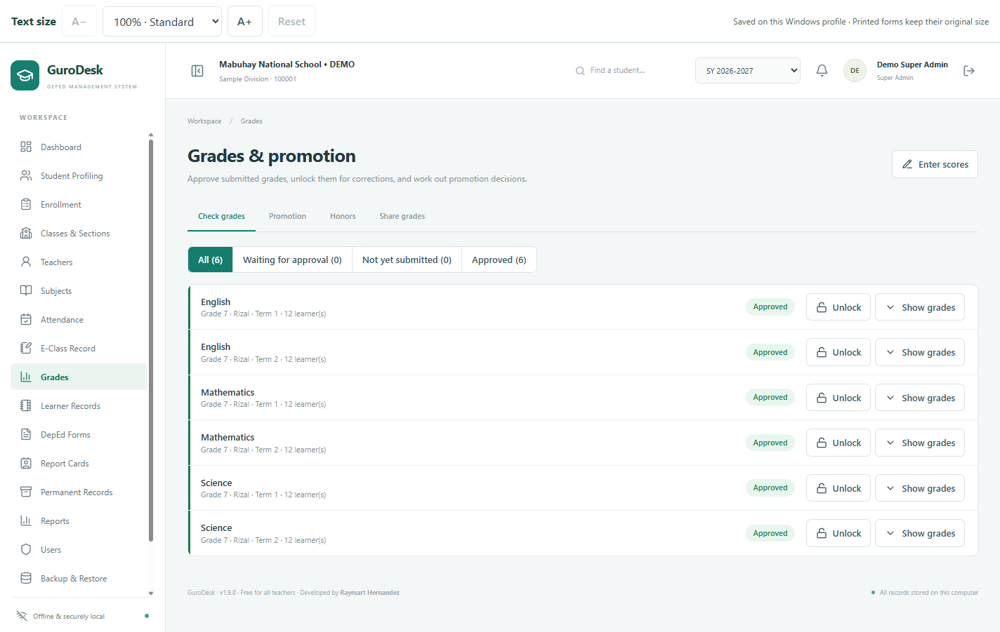
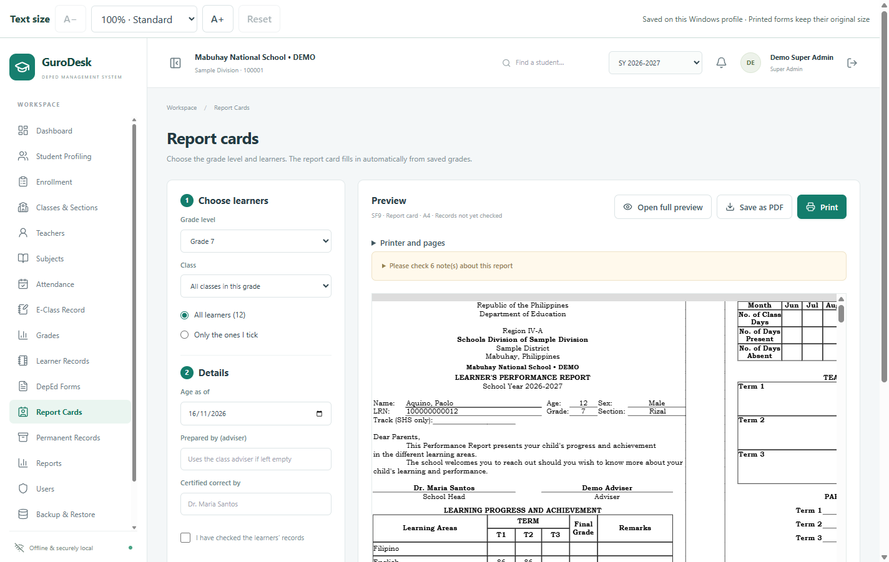

# GuroDesk

**School records, grades and DepEd forms, all in one offline desktop app.** 
Free for every teacher. No license, no internet, no subscription.

[-0078d4?style=flat-square&logo=windows&logoColor=white)](#system-requirements)

 

&nbsp;

  

[Features](#features) · [Screenshots](#screenshots) · [Getting started](#getting-started) · [Documentation](#documentation) · [FAQ](#frequently-asked-questions)

 

---

## Why GuroDesk?

GuroDesk keeps a school's learner records on the teacher's own computer and turns them into ready-to-print DepEd forms. Take attendance, type scores, and the app works out the grades, the promotion decisions, and every report card for you.

- **Built for DepEd.** It follows DO 015, s. 2026 grading (three terms, adjusted transmutation table) and lays out SF1–SF10 report forms for Kindergarten to Grade 12.
- **Private by design.** All records stay on your computer. Nothing is uploaded, and no account or internet connection is needed.
- **Made for daily use.** Big, labelled buttons and adjustable text size from 100% to 200%.

## Features

<table>
<tr>
<td width="33%" valign="top">

### 📋 Learners & enrollment
Learner profiles with photos and guardians, 12-digit LRN checks, and enrollment history. Import whole classes from LIS/SF1 exports or any Excel list.

</td>
<td width="33%" valign="top">

### ✅ Daily attendance
One tap per learner: Present, Absent, Late, or Excused. Monthly totals, past records, and a school-day calendar are built in.

</td>
<td width="33%" valign="top">

### 📝 E-Class Record
Written or Oral Works, Performance Tasks, and Examinations with DepEd weights. Grades are calculated as you type. Export to Excel.

</td>
</tr>
<tr>
<td valign="top">

### 🎓 Grades & promotion
Approve or unlock grades, calculate promotion for a whole class at once, and rank honors using configurable cut-offs.

</td>
<td valign="top">

### 🖨️ DepEd forms & report cards
SF1, SF2, SF3, SF4, SF5, SF6, SF8, SF9, and SF10, plus the honor roll and parent progress notices. Preview, print, or save each one as a PDF.

</td>
<td valign="top">

### 🩺 Learner records
Term comments, Kindergarten and Grade 1 checklists, BMI and nutritional status (WHO 2007), book lists, and learners who need help.

</td>
</tr>
<tr>
<td valign="top">

### 🔄 Share grades
Subject teachers send their grades to the adviser as a single file. The adviser previews the changes before importing them.

</td>
<td valign="top">

### 👩‍🏫 Teacher or school mode
**Single-User Teacher Mode** for your own laptop, or **Multi-User Mode** with roles and approvals for the whole school.

</td>
<td valign="top">

### 💾 Backup & restore
Automatic backups at startup and every four hours, with checksum and integrity checks before any restore.

</td>
</tr>
</table>

## Screenshots

<table>
<tr>
<td width="50%" align="center"> <b>Attendance</b>: mark each learner with one tap</td>
<td width="50%" align="center"> <b>E-Class Record</b>: scores become grades automatically</td>
</tr>
<tr>
<td align="center"> <b>Grades & promotion</b>: approve, unlock, and promote</td>
<td align="center"> <b>Report cards (SF9)</b>: filled in from saved grades</td>
</tr>
<tr>
<td align="center"> <b>DepEd forms</b>: SF1 to SF10, ready to print</td>
<td align="center" valign="middle">Screenshots show the built-in <b>demo school</b> with fictional learners.</td>
</tr>
</table>

## Getting started

1. **Download** `GuroDesk.Setup.1.9.0.exe` from the [latest release](https://github.com/rxbytecom/GuroDesk/releases/latest).
2. **Run the installer.** If Windows SmartScreen appears, click **More info → Run anyway**.
3. **Open GuroDesk** from the Start menu or desktop shortcut.
4. **Choose a mode.** Pick **Single-User Teacher Mode** to start right away, or **Multi-User Mode** to create an administrator account for your school.
5. **Set up your class**: add sections, subjects, and learners, and you're ready to take attendance and enter scores.

The [User Guide (PDF)](docs/GuroDesk-User-Guide-1.9.0.pdf) walks through every screen step by step.

> [!IMPORTANT]
> **To update, install the new version over the old one. Do not uninstall first.** Uninstalling deletes the app's local data, including school records and automatic backups.

### Downloads

| File | Description |
| :-- | :-- |
| [`GuroDesk.Setup.1.9.0.exe`](https://github.com/rxbytecom/GuroDesk/releases/latest/download/GuroDesk.Setup.1.9.0.exe) | **Installer (recommended).** Adds Start menu and desktop shortcuts and an uninstaller. |
| [`GuroDesk.1.9.0.exe`](https://github.com/rxbytecom/GuroDesk/releases/latest/download/GuroDesk.1.9.0.exe) | Portable version that runs without installing. |
| [`GuroDesk-User-Guide-1.9.0.pdf`](docs/GuroDesk-User-Guide-1.9.0.pdf) | Complete user guide. |
| [`SHA256SUMS.txt`](https://github.com/rxbytecom/GuroDesk/releases/latest/download/SHA256SUMS.txt) | Checksums for verifying your download. |

### System requirements

| | |
| :-- | :-- |
| **Operating system** | Windows 10 or 11, 64-bit |
| **Disk space** | About 700 MB for the app, plus space for your records and backups |
| **Internet** | Not required |
| **Printer** | Optional; any printer installed in Windows. Forms support A4, Legal, and Folio paper. |

## Documentation

| Guide | What's inside |
| :-- | :-- |
| 📘 [User Guide (PDF)](docs/GuroDesk-User-Guide-1.9.0.pdf) | Illustrated, step-by-step tutorial for every feature |
| ⚙️ [Installation & first use](docs/INSTALLATION.md) | Setup, data location, uninstalling, importing learners, printing |
| 👩‍🏫 [Teacher Mode](docs/TEACHER-MODE.md) | Using GuroDesk alone without logins |
| 📝 [Grade entry](docs/GRADE-ENTRY.md) | Grading methods per subject, weights, and report cards |
| 💾 [Backup & recovery](docs/BACKUP.md) | Creating, storing, and restoring backups |
| 📄 [Forms & policy sources](docs/POLICY-SOURCES.md) | Which DepEd templates are used and what to review |
| 📜 [Licensing](docs/LICENSING.md) | Free-use terms |
| 🗒️ [Release notes](docs/RELEASE-NOTES.md) | What changed in each version |

## Frequently asked questions

<b>Is GuroDesk really free?</b>

 
Yes. Starting with version 1.9.0 there is no trial, license code, activation, or payment. Every feature works on every computer, and teachers may copy and share the installer with other teachers.

<b>Does it need an internet connection?</b>

 
No. GuroDesk runs completely offline, and all records are stored on your own computer.

<b>Where is my data stored?</b>

 
In your Windows user's app-data folder (<code>%APPDATA%\deped-smart-school</code>). Automatic backups are kept in its <code>backups</code> subfolder. Copy important backups to another drive regularly. See <a href="docs/BACKUP.md">Backup & recovery</a>.

<b>How do I update to a new version?</b>

 
Download the new installer and run it over your current installation. Your records are kept. <b>Do not uninstall first</b>, because uninstalling deletes your local data.

<b>Windows says "Windows protected your PC". Is it safe?</b>

 
That SmartScreen message appears for apps that aren't code-signed. Click <b>More info → Run anyway</b>. You can confirm your download is unchanged by comparing its SHA-256 checksum with <code>SHA256SUMS.txt</code>:
<pre>Get-FileHash .\GuroDesk.Setup.1.9.0.exe -Algorithm SHA256</pre>

<b>Are the printed forms official?</b>

 
GuroDesk follows published DepEd layouts, but reports it generates are not LIS-issued documents and the app is not DepEd-certified. Have your school review forms and grading settings before official use. See <a href="docs/POLICY-SOURCES.md">Forms & policy sources</a>.

---

**GuroDesk** is developed by **Raymart Hernandez**. Free for all teachers. 🇵🇭

Made for Filipino teachers. If GuroDesk helps you, share it with a fellow teacher.

